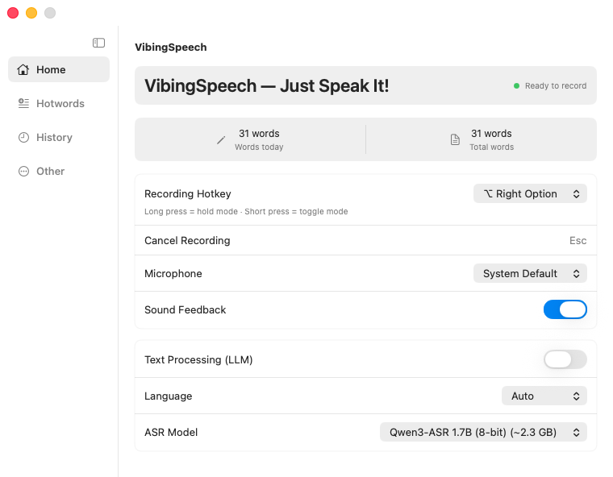
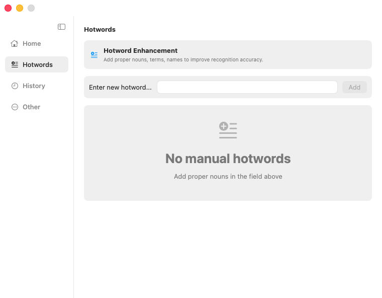
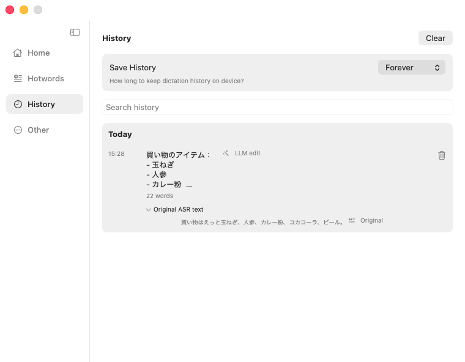
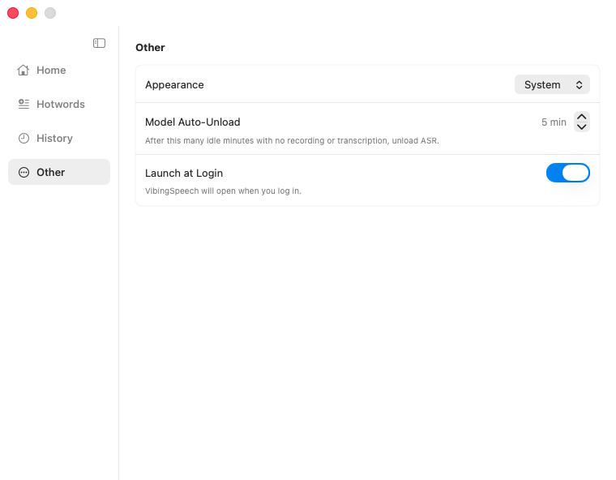

<table>
  <thead>
    <tr>
      <th style="text-align:center"><a href="README_ja.md">日本語</a></th>
      <th style="text-align:center"><a href="README.md">English</a></th>
    </tr>
  </thead>
</table>

# VibingSpeech

Local voice dictation for Apple Silicon Macs. Record from a global hotkey, transcribe with Granite Speech or Qwen3-ASR, optionally refine the text with LFM3, and paste it into the app you are using.

VibingSpeech lives in the menu bar. Audio and text inference run on your Mac; models download when first needed.

## Contents

- [Features](#features)
- [Requirements](#requirements)
- [Build and run](#build-and-run)
- [Usage](#usage)
- [Models](#models)
- [Privacy and model lifecycle](#privacy-and-model-lifecycle)
- [Screenshots](#screenshots)
- [Testing](#testing)
- [Release archive and signing](#release-archive-and-signing)
- [Troubleshooting](#troubleshooting)
- [Project structure](#project-structure)
- [License](#license)

## Features

- Tap the recording hotkey to start and stop, or hold it while speaking. Press Escape to cancel.
- Choose a microphone independently of the macOS default, including when Bluetooth headphones are used for playback.
- Review an optional live transcript above the compact recording overlay. Final text is pasted once after recording stops.
- Apply typo correction, bullet-point formatting, or a custom instruction with optional local Text Processing.
- Supply vocabulary hints to final Qwen3-ASR transcription through Hotwords.
- Search transcription history and copy either edited text or the original ASR result. Choose how long history is retained.
- Configure appearance, Launch at Login, sound feedback, and idle model unloading.

## Requirements

- An **Apple Silicon Mac** running **macOS 26.0 or later**. Intel Macs are unsupported.
- Xcode with Swift 6.2 or later and the Metal Toolchain installed. Development was verified with Xcode 27.2 and Swift 6.4.2.
- Microphone permission for recording and Accessibility permission for global hotkeys and cross-app paste.
- Internet access for initial dependency and model downloads, plus disk space for the selected models.
- `llama` for optional Text Processing. If it is missing, the app runs `curl -LsSf https://llama.app/install.sh | sh`. An existing installation is used without replacement.

## Build and run

Clone or download this repository, then run from its root:

```sh
./script/build_and_run.sh --verify
```

The script stops any running VibingSpeech process, builds the Debug app through `VibingSpeech.xcodeproj`, launches it, and checks that it is running. Build products are stored in `DerivedData/`. The Xcode project is the primary build entry point; the local Swift package supplies the native ASR wrapper.

Use `./script/build_and_run.sh` for a normal launch, or pass `--logs`, `--telemetry`, or `--debug` for diagnostics.

## Usage

1. Launch VibingSpeech and allow microphone access.
2. Enable it in **System Settings → Privacy & Security → Accessibility**.
3. In **Home**, choose a microphone and **Final ASR Model**. Wait for model preparation to finish.
4. Place the cursor in a text field, for example in Notes. Tap **Right Option**, speak, then tap it again to stop and paste the result.

Right Option is the default hotkey; Left Control is also available. A long press records until the key is released. **Escape** cancels recording or processing.

Enable **Live Transcription** to review text while speaking and choose a separate **Live Model**. Live text is never pasted. After stopping, the complete mono 16 kHz recording is transcribed in one native batch call, then optionally processed by the LLM before insertion. Model input limits are reported as errors rather than silently truncating audio.

Enable **Text Processing (LLM)** to select **Fix Typos**, **Bullet Points**, or **Custom**. The Language setting controls the requested output language; Auto follows the detected language when available, otherwise the input text.

Use **Hotwords** for final Qwen3-ASR vocabulary hints; Granite CTC does not support prompt hints. Use **History** for saved dictations and **Other** for appearance, Launch at Login, and Model Auto-Unload.

## Models

Final ASR and live review use separate models. The former 1.7B 4-bit option is no longer available.

| Purpose | Model | Format | Runtime | Approximate download |
| --- | --- | --- | --- | --- |
| Final ASR, default | [Granite Speech 5.0 470M TurboCTC](https://huggingface.co/vladers/granite-speech-5.0-470m-turboctc-GGUF) | GGUF Q8_0 | transcribe.cpp | 520 MB |
| Final ASR | [Qwen3-ASR 1.7B](https://huggingface.co/handy-computer/Qwen3-ASR-1.7B-gguf) | GGUF Q8_0 | transcribe.cpp | 2.2 GB |
| Optional Text Processing | [LFM3 1.7B](https://huggingface.co/LiquidAI/LFM3-1.7B-GGUF) | GGUF Q6_K | llama.cpp, non-thinking | 1.4 GB |

The GGUF filenames are:

- `granite-speech-5.0-470m-turboctc-Q8_0.gguf`
- `Qwen3-ASR-1.7B-Q8_0.gguf`
- `LFM3-1.7B-Q6_K.gguf`

Qwen3-ASR must use the **handy-computer** conversion. The ggml-org conversion has a different layout intended for llama.cpp and is not interchangeable with this transcribe.cpp model.

Live review retains the MLX 8-bit models [Qwen3-ASR 0.6B](https://huggingface.co/mlx-community/Qwen3-ASR-0.6B-8bit) and [Qwen3-ASR 1.7B](https://huggingface.co/mlx-community/Qwen3-ASR-1.7B-8bit). They are loaded when live transcription is used, in addition to the selected final ASR model.

Final ASR uses transcribe.cpp `v0.4.2` through a checksum-pinned XCFramework. Live inference uses `mlx-audio-swift` `0.1.3` with `mlx-swift` `0.31.6`.

## Privacy and model lifecycle

Audio and inference stay local. Settings, Hotwords, and history are stored on your Mac. Model downloads and the optional llama installer require network access.

GGUF files use the shared `~/.cache/huggingface/hub` snapshots/blobs cache with SHA-256 verification. These public models need no token entry in the app. Existing credentials from `HF_TOKEN` or the Hugging Face token file are honored; `HF_TOKEN_PATH` and `HF_HOME` can locate that token file.

Text Processing starts its own llama server on `127.0.0.1` with a private API key. It tries ports **49271, 49283, 49307, 49319, 49331, and 49349**, avoiding llama defaults and leaving other applications' servers untouched.

**Model Auto-Unload** defaults to five idle minutes. At the configured timeout, ASR models unload and the owned llama server stops. Setting the delay to Off disables this idle timeout. The server also stops when Text Processing is disabled, processing is canceled, or the app exits. Downloaded cache files remain available for later use.

## Screenshots

These screenshots show an earlier model configuration. Model names and some explanatory text differ from the current implementation; use the Models section above for current selections.



<details>
<summary>Hotwords, History, and Other settings</summary>







</details>

## Testing

Run unit tests without loading models or requesting microphone permission:

```sh
xcodebuild -project VibingSpeech.xcodeproj \
  -skipPackagePluginValidation \
  -scheme VibingSpeech \
  -configuration Debug \
  -destination 'platform=macOS,arch=arm64' \
  -derivedDataPath /tmp/VibingSpeech-Tests \
  CODE_SIGNING_ALLOWED=NO \
  -only-testing:VibingSpeechTests \
  test
```

The temporary build location avoids the macOS Documents access prompt encountered when XCTest loads the embedded native framework from a repository under Documents. The shared test action passes `--ui-testing` to keep startup independent of model downloads and microphone hardware.

Tests cover settings migration, historical model identifiers, prompt construction, ordered live audio delivery, history retention and recovery, verified GGUF caching, server port fallback, authentication, cancellation, and shutdown. The opt-in microphone test is skipped unless a test device is configured. UI automation requires a trusted macOS development-signing identity; an ad-hoc archive signature does not supply that identity.

## Release archive and signing

Create a release bundle with:

```sh
./script/archive.sh
```

The script replaces its previous outputs at `build/VibingSpeech.xcarchive` and `build/VibingSpeech.app`. It builds for arm64, signs nested code before the app using **ad-hoc signing** (`--sign -`), enables Hardened Runtime, and preserves the Audio Input entitlement. It verifies the signature, runtime flag, and embedded Version/Build against Xcode settings.

Change the app version through `MARKETING_VERSION` and `CURRENT_PROJECT_VERSION` in `VibingSpeech.xcodeproj`. Keep the corresponding `Info.plist` placeholders intact. This workflow creates an ad-hoc signed local bundle, not a notarized Developer ID distribution.

## Troubleshooting

| Symptom | Check |
| --- | --- |
| Hotkey or paste does not work | Enable Accessibility access, then use **Retry Hotkey Setup** in Home. |
| Selected microphone is unavailable | Reconnect it or select another input, then start a new recording. Device selection is applied at recording start. |
| Text Processing cannot start | Check the status message and that `llama` is installed and supports LFM3. An outdated installation reports a startup error rather than being replaced automatically. |
| All inference ports are occupied | Free one of the listed ports or close another VibingSpeech instance, then retry. |
| Models unload while the app is idle | Adjust **Other → Model Auto-Unload**, or set it to Off. |
| A very brief recording produces no text | Audio shorter than the ASR minimum is discarded. |
| XCTest waits before app startup | Use the temporary derived-data location in the Testing command. |

## Project structure

| Path | Responsibility |
| --- | --- |
| `VibingSpeech.xcodeproj` | Primary app, unit-test, and UI-test targets |
| `VibingSpeech/App` | App lifecycle and recording coordinator |
| `VibingSpeech/Services` | Microphone capture, ASR, llama server, model downloads, permissions, and paste |
| `VibingSpeech/Persistence` | Settings, history journal, and Hotwords |
| `VibingSpeech/Views` | SwiftUI screens and recording overlays |
| `Packages/TranscribeRuntime` | Native transcribe.cpp model ownership, inference, and cancellation |
| `script` | Build/run and release archive entry points |

The app uses SwiftUI, AppKit, Core Audio, AVFoundation, Carbon, and ServiceManagement.

## License

VibingSpeech is [MIT licensed](LICENSE). Libraries and model weights have their own licenses; review them separately. Bundled transcribe.cpp notices are in [TranscribeThirdPartyNotices.txt](VibingSpeech/Resources/TranscribeThirdPartyNotices.txt).
