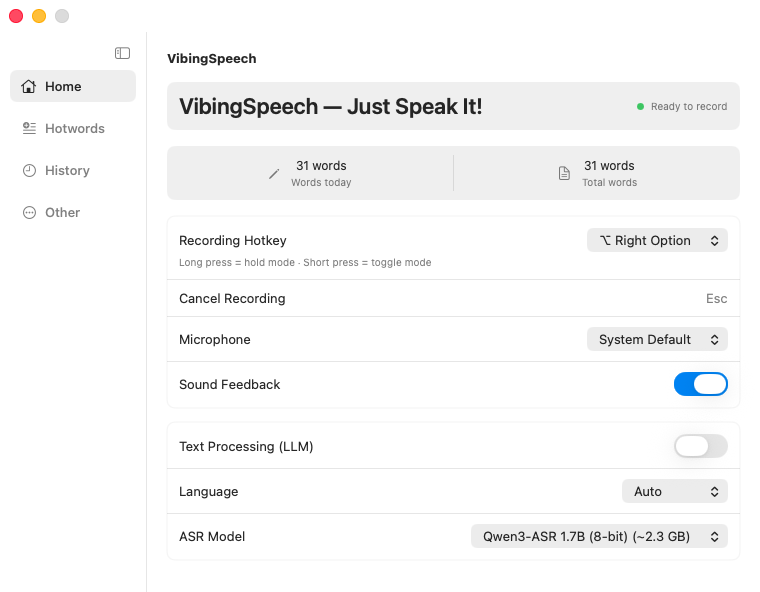
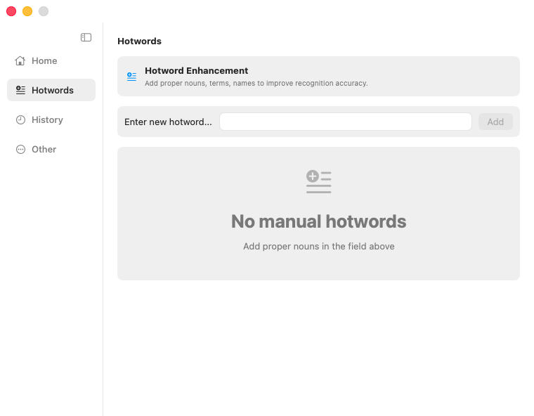
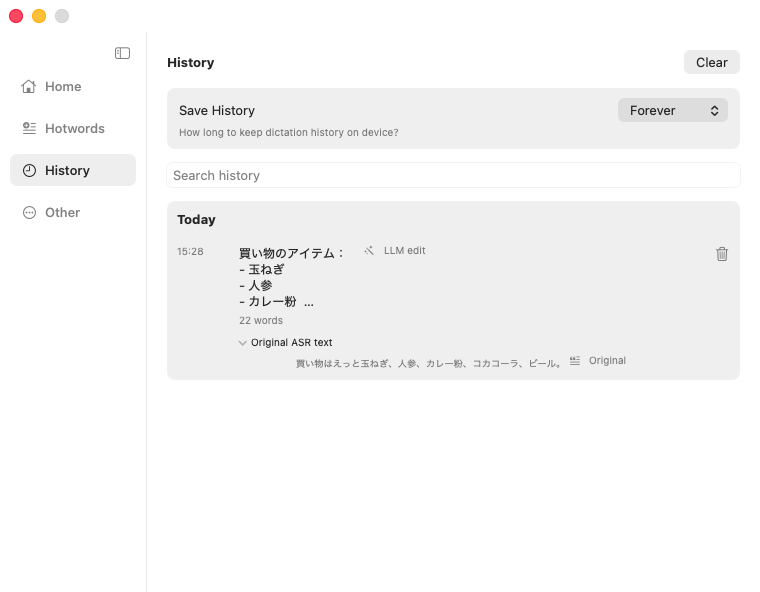
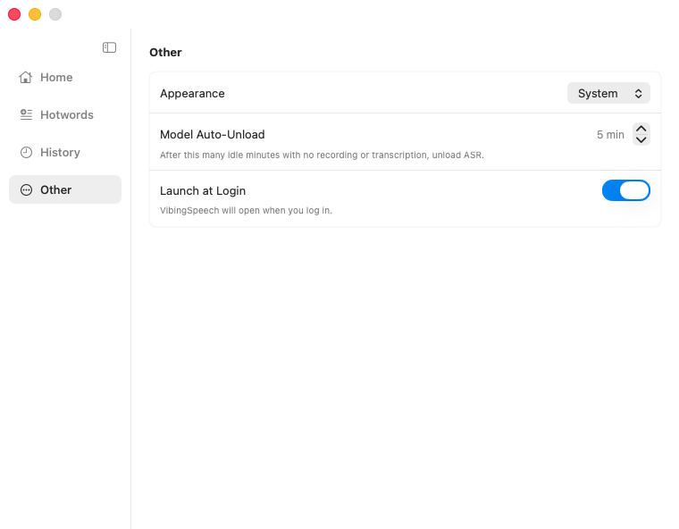

<table>
  <thead>
    <tr>
      <th style="text-align:center"><a href="README_ja.md">日本語</a></th>
      <th style="text-align:center"><a href="README.md">English</a></th>
    </tr>
  </thead>
</table>

# VibingSpeech

Apple Silicon Mac 向けのローカル音声入力アプリです。ホットキーで録音し、Granite Speech または Qwen3-ASR で文字起こしします。必要に応じて Qwen3 Instruct 2507 で文章を整え、使用中のアプリへ貼り付けます。

メニューバーに常駐し、音声とテキストの推論は Mac 内で実行します。必要なモデルは初回使用時にダウンロードします。

## 目次

- [機能](#features)
- [動作要件](#requirements)
- [ビルドと実行](#build-and-run)
- [使い方](#usage)
- [モデル](#models)
- [プライバシーとモデル管理](#privacy-and-model-lifecycle)
- [画面例](#screenshots)
- [テスト](#testing)
- [リリース用アーカイブと署名](#release-archive-and-signing)
- [トラブルシューティング](#troubleshooting)
- [プロジェクト構成](#project-structure)
- [ライセンス](#license)

<a id="features"></a>

## 機能

- 録音ホットキーの短押しで開始・停止、長押しで押している間だけ録音。Escape でキャンセル。
- macOS の既定とは別に入力マイクを選択。Bluetooth ヘッドホンで再生している場合も、選択したマイクを使用。
- コンパクトな録音パネルの上にライブ文字起こしを表示。確定テキストの貼り付けは停止後の一度だけ。
- ローカルの Text Processing で誤字修正、箇条書き化、カスタム指示による整形。
- Hotwords から確定用 Qwen3-ASR へ語彙ヒントを指定。
- 履歴の検索、整形後テキストと元の文字起こしのコピー、保存期間の指定。
- 外観、ログイン時の起動、操作音、アイドル時のモデル解放を設定。

<a id="requirements"></a>

## 動作要件

- **macOS 26.0 以降**を搭載した **Apple Silicon Mac**。Intel Mac は非対応です。
- Swift 6.2 以降を含む Xcode。開発時には Xcode 27.2／Swift 6.4.2 で確認しています。
- 録音用のマイク権限と、グローバルホットキー・アプリ間の貼り付け用のアクセシビリティ権限。
- 依存パッケージとモデルの初回ダウンロード用のネット接続、および選択したモデルを保存する空き容量。
- Text Processing を使う場合は `llama`。未導入ならアプリが `curl -LsSf https://llama.app/install.sh | sh` を実行します。導入済みなら既存のものを使用します。

<a id="build-and-run"></a>

## ビルドと実行

リポジトリをクローンまたはダウンロードし、ルートで実行します。

```sh
./script/build_and_run.sh --verify
```

このスクリプトは起動中の VibingSpeech を停止し、`VibingSpeech.xcodeproj` から Debug アプリをアドホック署名付きでビルドします。アプリとネイティブフレームワークの署名を検証してから起動し、5秒間の稼働を確認します。出力先は `DerivedData/` です。アプリ本体は Xcode プロジェクトでビルドし、ローカル Swift パッケージはネイティブ ASR のラッパーを提供します。

Debug と Release の両方で Hardened Runtime を有効にしています。アドホック署名には Team ID がないため、内蔵の `CTranscribe.framework` を読み込めるよう Disable Library Validation entitlement を付与しています。

ビルドスクリプトはパッケージ認証に netrc を指定し、公開の依存関係を取得するときのキーチェーン確認を避けます。

通常起動には `./script/build_and_run.sh` を使用します。診断用に `--logs`、`--telemetry`、`--debug` も指定できます。

<a id="usage"></a>

## 使い方

1. VibingSpeech を起動し、マイクへのアクセスを許可します。
2. **システム設定 → プライバシーとセキュリティ → アクセシビリティ**で VibingSpeech を有効にします。
3. **Home** でマイクと **Final ASR Model** を選び、モデルの準備が完了するまで待ちます。
4. メモなどの入力欄へカーソルを置きます。**右 Option** を短押しして話し、もう一度短押しすると停止して結果を貼り付けます。

既定のホットキーは右 Option です。左 Control も選べます。長押しの場合はキーを離すと録音が停止します。**Escape** で録音や処理をキャンセルできます。

録音中のテキストを確認するには **Live Transcription** を有効にします。**Nemotron 3.5 ASR Streaming 0.6B** を使用し、Live Model 行には固定の Q8_0 モデルを表示します。初回は約750 MB のダウンロードと読み込みの間、Home に準備状況を表示し、準備完了後に録音を開始します。ライブ表示は貼り付けられません。停止後にモノラル 16 kHz の録音全体をネイティブ ASR へ一度に渡し、必要に応じて LLM で処理してから挿入します。モデルの入力上限を超えた場合は、音声を黙って切り捨てずエラーを表示します。

文章を整えるには **Text Processing (LLM)** を有効にし、**Fix Typos**、**Bullet Points**、**Custom** を選びます。Language は出力先の言語を指定します。Auto は検出言語があればそれに従い、なければ入力テキストの言語を使用します。

**Hotwords** の語彙ヒントは確定用 Qwen3-ASR に適用されます。Granite CTC はプロンプトによるヒントに非対応です。**History** では履歴を、**Other** では外観・ログイン時の起動・モデル自動解放を設定します。

組み込みプロンプトは短く、例文を含みません。**Fix Typos** は意味を保った最小限の修正を指示します。**Bullet Points** は話した考えを順番に整理し、列挙されたものは別々の項目にします。リストの見出しは元の発話にある場合だけ残します。

<a id="models"></a>

## モデル

確定文字起こしとライブ表示には別々のモデルを使います。ライブ用 Qwen MLX と従来の 1.7B・4-bit は削除済みです。廃止したモデル設定の移行処理はなく、保存済みの確定 ASR 設定を認識できない場合は現在の既定モデルを使います。

| 用途 | モデル | 形式 | 実行エンジン | ダウンロードの目安 |
| --- | --- | --- | --- | --- |
| 確定 ASR・既定 | [Granite Speech 5.0 470M TurboCTC](https://huggingface.co/vladers/granite-speech-5.0-470m-turboctc-GGUF) | GGUF Q8_0 | transcribe.cpp | 520 MB |
| 確定 ASR | [Qwen3-ASR 1.7B](https://huggingface.co/handy-computer/Qwen3-ASR-1.7B-gguf) | GGUF Q8_0 | transcribe.cpp | 2.2 GB |
| ライブ表示 | [Nemotron 3.5 ASR Streaming 0.6B](https://huggingface.co/handy-computer/nemotron-3.5-asr-streaming-0.6b-gguf) | GGUF Q8_0 | transcribe.cpp | 750 MB |
| 任意の Text Processing | [Qwen3 4B Instruct 2507](https://huggingface.co/unsloth/Qwen3-4B-Instruct-2507-GGUF) | GGUF Q4_K_M | llama.cpp・非推論モード | 2.5 GB |

使用する GGUF ファイルは以下のとおりです。

- `granite-speech-5.0-470m-turboctc-Q8_0.gguf`
- `Qwen3-ASR-1.7B-Q8_0.gguf`
- `nemotron-3.5-asr-streaming-0.6b-Q8_0.gguf`
- `Qwen3-4B-Instruct-2507-Q4_K_M.gguf`

Text Processing は非推論専用の Instruct 2507 モデルを使用します。設定は `temperature=0.7`、`top_p=0.8`、`top_k=20`、`min_p=0.0`、`presence_penalty=0.0`、`repeat_penalty=1.0`（llama.cpp での repetition penalty の名前）で、出力上限は 16,384 トークンです。推論モードを切り替える指定は不要です。[モデル推奨設定](https://huggingface.co/Qwen/Qwen3-4B-Instruct-2507#best-practices)に基づいています。

Qwen3-ASR は **handy-computer 版**を使用します。ggml-org 版は llama.cpp 向けの異なる構造のため、この transcribe.cpp 用モデルとは交換できません。

ライブ表示には transcribe.cpp 用に変換された Nemotron 3.5 を使用します。日本語と多言語のストリーミング、言語指定と Auto、240 ms の先読み処理に対応します。ライブ文字起こしを使うと、選択した確定 ASR モデルに加えて読み込みます。ストリーミングは確認専用で、停止後の確定 ASR は録音全体を別途処理します。

ライブ・確定 ASR ともに、チェックサムで固定した XCFramework を通じて transcribe.cpp `v0.4.2` を使用します。MLX への依存はありません。NVIDIA 公式の `nemo-speech` の導入は不要で、導入済みの本体やキャッシュも変更しません。公式版と transcribe.cpp 版は GGUF の内部形式が異なるため、公式版で取得済みのモデルはそのまま再利用できません。

<a id="privacy-and-model-lifecycle"></a>

## プライバシーとモデル管理

音声と推論処理はローカルにとどまります。設定・Hotwords・履歴も Mac 内に保存します。モデルのダウンロードと、必要な場合の llama インストールにはネット接続を使います。

GGUF は共通の `~/.cache/huggingface/hub` に snapshots/blobs 形式で保存し、SHA-256 で検証します。公開モデルのため、アプリへのトークン入力は不要です。既存の `HF_TOKEN` または Hugging Face のトークンファイルを利用でき、`HF_TOKEN_PATH` と `HF_HOME` によるトークンファイルの指定にも対応します。

Text Processing は専用の API キーを持つ llama サーバーを `127.0.0.1` に起動します。標準ポートを避け、**49271、49283、49307、49319、49331、49349** の順に試します。他のアプリのサーバーへ接続したり、停止したりしません。

**Model Auto-Unload** の既定はアイドル 5 分です。指定時間が経つと ASR モデルを解放し、アプリ専用の llama サーバーを停止します。Off にするとアイドル時の自動解放を無効にします。Text Processing を無効にしたとき、処理をキャンセルしたとき、アプリ終了時にもサーバーを停止します。ダウンロード済みのキャッシュは再利用のために残します。

<a id="screenshots"></a>

## 画面例

以下は以前のモデル構成で撮影した画面です。モデル名や一部の説明文は現在の実装と異なります。現在の選択肢は上のモデル一覧を参照してください。



<details>
<summary>Hotwords・History・Other の画面</summary>







</details>

<a id="testing"></a>

## テスト

モデルの読み込みやマイク権限の要求を行わず、単体テストを実行します。

```sh
xcodebuild -project VibingSpeech.xcodeproj \
  -packageAuthorizationProvider netrc \
  -scheme VibingSpeech \
  -configuration Debug \
  -destination 'platform=macOS,arch=arm64' \
  -derivedDataPath /tmp/VibingSpeech-Tests \
  CODE_SIGNING_ALLOWED=NO \
  -only-testing:VibingSpeechTests \
  test
```

ネイティブのストリーミングパッケージには独立したテストもあります。

```sh
swift test --package-path Packages/TranscribeRuntime --disable-keychain
```

パッケージのテストは4件で、モデル不要の確認2件と実モデルの統合テスト2件です。実モデルのテストは任意実行です。`VIBINGSPEECH_TEST_NEMOTRON_GGUF` に対応する Q8_0 ファイルを、`VIBINGSPEECH_TEST_NEMOTRON_PCM` にモノラル 16 kHz・リトルエンディアン float32 の PCM ファイルを指定します。未指定なら、モデル不要のテストだけを実行します。

一時フォルダーを使うのは、Documents 内のリポジトリから XCTest がネイティブ framework を読み込む際に発生した、macOS のファイルアクセス確認を避けるためです。共有スキームのテスト起動引数には `--ui-testing` を指定し、モデルのダウンロードやマイク機器に依存しない構成にしています。

設定の保存、プロンプト生成、ライブ音声の順序、履歴の保存期間と復旧、GGUF キャッシュ検証、ポート切り替え、認証、キャンセル、サーバー停止をテストします。マイク実機テストは対象デバイスを指定しない限りスキップします。UI 自動テストには信頼済みの macOS 開発署名が必要で、アドホック署名ではその開発署名を代替できません。

<a id="release-archive-and-signing"></a>

## リリース用アーカイブと署名

配布用のアプリバンドルを作成します。

```sh
./script/archive.sh
```

既存の出力先 `build/VibingSpeech.xcarchive` と `build/VibingSpeech.app` は置き換えます。arm64 向けにビルドし、内部コードからアプリ本体の順に**アドホック署名**（`--sign -`）を行います。Hardened Runtime と Audio Input・Disable Library Validation の両 entitlement を維持し、署名・runtime フラグ・必須の両 entitlement・アプリ内の Version／Build と Xcode 設定の一致を検証します。

バージョンは `VibingSpeech.xcodeproj` の `MARKETING_VERSION` と `CURRENT_PROJECT_VERSION` で変更し、`Info.plist` の対応する変数参照は維持します。この手順で生成するのはアドホック署名済みのローカル用バンドルであり、Developer ID 署名・公証済みの配布物ではありません。

<a id="troubleshooting"></a>

## トラブルシューティング

| 症状 | 確認すること |
| --- | --- |
| ホットキーや貼り付けが動かない | アクセシビリティ権限を有効にし、Home の **Retry Hotkey Setup** を使用します。 |
| 選択したマイクが使えない | 再接続するか別の入力を選び、録音し直します。デバイス選択は録音開始時に適用します。 |
| Text Processing が起動しない | 状態表示を確認し、`llama` が導入済みで Qwen3 Instruct 2507 に対応しているか確認します。古いものは自動更新せず、起動エラーを表示します。 |
| 推論用ポートがすべて使用中 | 候補ポートのいずれかを空けるか、別の VibingSpeech を終了して再試行します。 |
| アイドル中にモデルが解放される | **Other → Model Auto-Unload** の時間を変更するか、Off にします。 |
| ごく短い録音で文字が出ない | ASR の最小長に満たない音声は破棄します。 |
| XCTest がアプリ起動前に待機する | テスト手順にある一時フォルダーをビルド先に使用します。 |

<a id="project-structure"></a>

## プロジェクト構成

| パス | 役割 |
| --- | --- |
| `VibingSpeech.xcodeproj` | アプリ・単体テスト・UI テストの主要ターゲット |
| `VibingSpeech/App` | アプリのライフサイクルと録音処理の管理 |
| `VibingSpeech/Services` | マイク収録・ASR・llama サーバー・モデル取得・権限・貼り付け |
| `VibingSpeech/Persistence` | 設定・履歴ジャーナル・Hotwords |
| `VibingSpeech/Views` | SwiftUI 画面と録音オーバーレイ |
| `Packages/TranscribeRuntime` | transcribe.cpp のモデル管理・推論・キャンセル |
| `script` | ビルド・起動とリリース用アーカイブの入口 |

SwiftUI、AppKit、Core Audio、AVFoundation、Carbon、ServiceManagement を使用しています。

<a id="license"></a>

## ライセンス

VibingSpeech は [MIT ライセンス](LICENSE)です。ライブラリとモデルの重みにはそれぞれ別のライセンスが適用されます。[TranscribeThirdPartyNotices.txt](VibingSpeech/Resources/TranscribeThirdPartyNotices.txt) に同梱 transcribe.cpp のライセンス通知を収録しています。
